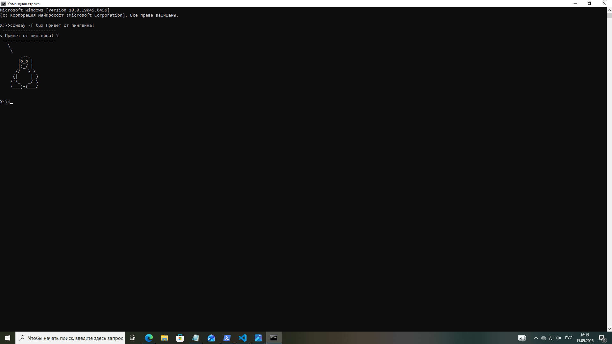
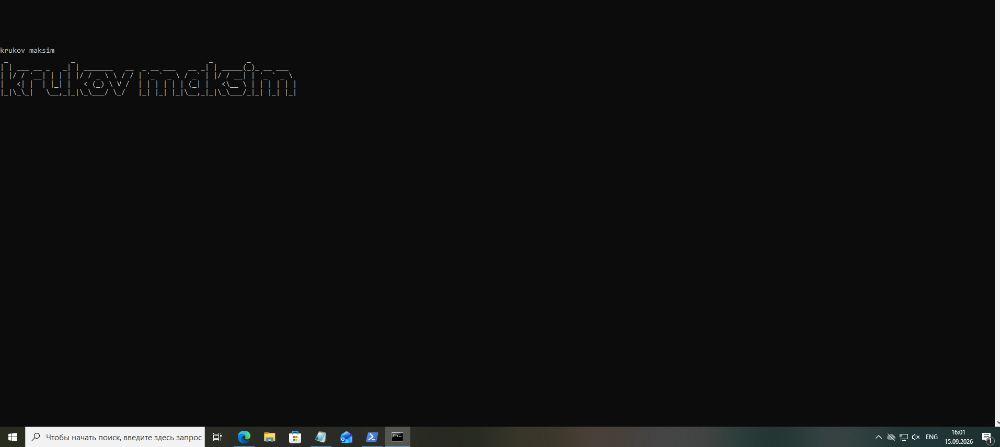

# Название проекта / Темы 

> **Дата:** 09.03.2010 
> **Автор (ФИО):** Крюков максим Витальевич

## ВЫПОЛНЕННЫЕ ШАГИ
1. Освоена навигация в системе через команды.
2. Создана и очищена структура папок 'Лабиринт'.
3. Установлены и протестированы утилиты визуализации.

 ## ЛАБИРИНТ
[Открыть текстовый файл](document.txt)

## ОТЧЕТ СИСТЕМЫ
### Системная информация
![Fastfetch]

### Красивый текст
![Figlet]

### Сообщение от Cowsay
![Cowsay]